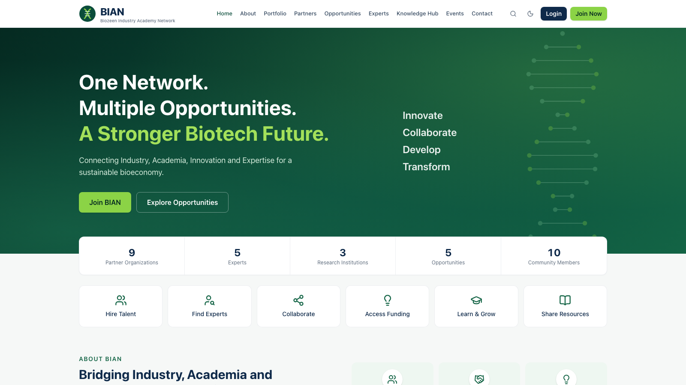

# Guide for visitors

You can explore most of BIAN without an account. Items marked **Members** or **Restricted** need you to sign in, and some need a particular membership.

## What you can see

| Page | Where | What's there |
|---|---|---|
| Homepage | `/` | What BIAN does, live network numbers, latest opportunities, partners, events, announcements and Knowledge Hub highlights. **Watch Video** plays the introduction when one is set |
| About & Company Portfolio | `/about`, `/portfolio` | Biozeen's services, projects and case studies |
| Partner Ecosystem | `/partners` | Founding, knowledge, industry and innovation partners. Open a partner for their profile and collaboration areas |
| Opportunities Hub | `/opportunities` | Jobs, internships, consultancy, funding, technology transfer and collaboration calls. Search and filter by type, location and organisation |
| Knowledge Hub | `/knowledge` | Industry insights, research repository, regulatory corner, learning centre and courses |
| Experts Network | `/experts` | Public expert profiles. Search by expertise, type and location |
| Events & Announcements | `/events` | Upcoming and past events and the latest announcements |
| Contact & Collaboration Center | `/contact` | Send an enquiry to the BIAN secretariat |
| Search | magnifier icon | Searches opportunities, resources, events and experts at once |

## Send an enquiry

1. Open **Contact**.
2. Fill in your name, email, category and **Requirement Type** (collaboration, partnership, expert connect, training, support, requirement or general), then your message.
3. Click **Send Message**. The secretariat replies by email. If you are signed in when you send it, the reply also appears under **Dashboard → Requests & Messages**.

## Join BIAN

1. Click **Join Now** (or **Register here →** on the login page).
2. **Select Category.** Organisations choose *Startups & Innovation Ecosystems*, *Academia & Research* or *Industry*. Individuals choose *Individual Experts (SME)*, *Alumni*, *Student* or *Professional*.
3. **Details.** Your name, email and a password of at least 10 characters with letters and numbers. Organisations add the organisation's name and details; individuals add their institution, designation or graduation year as relevant.
4. **Review & Submit**, accepting the terms.
5. **Verify your email** with the link we send you.
6. **Wait for approval.** The BIAN team reviews new registrations. You get a notification when you are approved, and can then sign in.

> Signing in before approval shows "Your registration is awaiting approval".

## Some sections are missing?

The BIAN team can switch screens on or off for visitors and for each member category. If a section you expect isn't in the menu, it isn't available for visitors at the moment. Members may see more after signing in.
