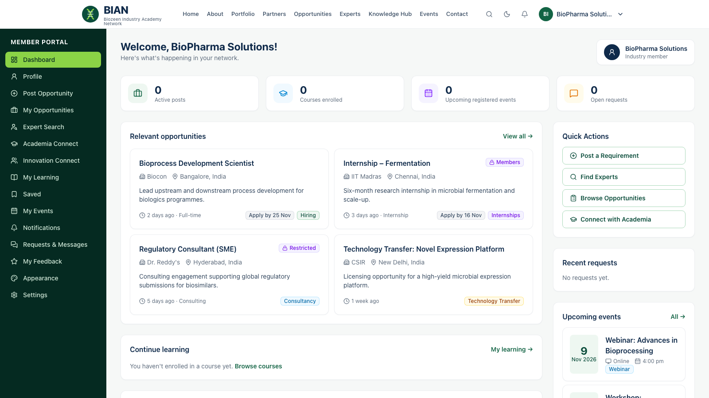

# Guide for organisation members

**For:** representatives of **Startups & Innovation Ecosystems**, **Academia & Research** institutions and **Industry** organisations.

Your account is linked to your organisation. You see members-only content, and anything shared with your organisation or category. You can post requirements, connect with experts and manage your company profile. Sign-in, notifications and appearance are covered in [Things everyone can do](README.md#things-everyone-can-do).

## Your Member Portal

After signing in you land on **Dashboard**. It shows:

- **Counts** of your active posts, courses, registered events and open requests.
- **Relevant opportunities**, which can include listings visible only to members or to your category (marked *Members* or *Restricted*).
- **Quick Actions**: Post a Requirement, Find Experts, Browse Opportunities, Connect with Academia.
- **Recent requests** with secretariat replies, **Upcoming events**, **Continue learning**, the latest knowledge resources and announcements.

The sidebar menu:

| Menu | Use it to |
|---|---|
| Profile | Update your details and your **company profile** |
| Post Opportunity · My Opportunities | Post a requirement and track its review |
| Expert Search | Find experts by skill or domain |
| Academia Connect · Innovation Connect | Browse academic and innovation partners |
| My Learning · Saved · My Events | Courses, bookmarked items and event registrations |
| Notifications · Requests & Messages | Live updates and secretariat conversations |
| My Feedback | Feedback you have submitted |
| Appearance · Settings | Theme, password and devices |

## Post a requirement or opportunity

1. **Dashboard → Post Opportunity.**
2. Enter a clear title and a summary of a few sentences.
3. Choose the type (job, internship, consultancy, funding, technology transfer, collaboration and so on). Add the location, deadline, how to apply (link or email) and any eligibility.
4. Click **Submit for review**. It goes to the BIAN team for review and is listed under **My Opportunities** as *Pending review*.
5. When it is published you get a notification with a link to the live listing. Members in its audience are notified too.

## Keep your company profile current

**Dashboard → Profile → Company profile.** Update the description, website, location and collaboration areas. Your organisation appears in the public **Partner Ecosystem** only after BIAN approves it and makes it public. Internal contact details are never shown publicly.

## Connect with an expert

1. Open **Expert Search** (or **Experts** in the header) and open a profile.
2. Click **Request to connect**, choose the purpose (mentoring, consultancy, collaboration, training or other) and describe what you need, then **Send request**.
3. The secretariat coordinates the introduction. Follow progress under **Requests & Messages**; you are notified of each reply.

## Learn, register and give feedback

- **Courses:** Knowledge Hub → Courses → **Enroll for free**. Use **Mark as complete** on each lesson; progress shows on your dashboard and under **My Learning**.
- **Events:** open an event and **Register**. Online meeting links appear only after you register. Your registrations are under **My Events**.
- **Save** any opportunity or resource to find it later under **Saved**.
- **Feedback:** rate courses, lessons, events and resources where a feedback form appears. Some forms let you answer anonymously.

## Tips

- Does a listing say *Restricted*? It is shared with other categories or organisations. Ask the secretariat if you need access.
- Can't see your organisation's details? Ask the BIAN team to link your account to the organisation in the Master Database.
