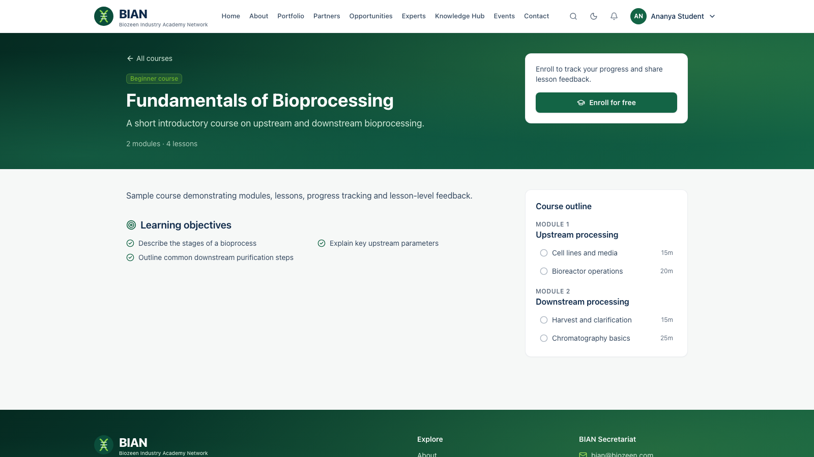

# Guide for individual members

**For:** **Individual Experts (SME)**, **Alumni**, **Students** and **Professionals**.

Sign-in, notifications and appearance are covered in [Things everyone can do](README.md#things-everyone-can-do).

## What your category gives you

Every approved member gets the **Member** role plus the role for their category:

| Category | Roles on approval | You can |
|---|---|---|
| Individual Expert (SME) | Member, Individual Expert | See members-only content and content for experts, post opportunities, request expert introductions |
| Alumni | Member, Alumni | The same, plus content for alumni |
| Professional | Member, Professional | The same, plus content for professionals |
| Student | Member, Student | The same, plus content for students |

The BIAN team can grant extra roles, for example access to a closed programme, or narrow a member's roles.

## Your Member Portal

**Dashboard** gathers what's relevant to you: opportunities you can apply for, courses in progress, events you've registered for, announcements, and replies to your requests. The menu matches the [organisation guide](02-organisation-members.md#your-member-portal).

## Find and apply for opportunities

1. **Opportunities** in the header, or **View all** on your dashboard.
2. Filter by type (jobs, internships, fellowships, funding…), location or organisation, or search.
3. Open a listing to read the details and eligibility. Use **Apply** (or the email shown) before the deadline.
4. **Save** listings you want to come back to.

New opportunities published for your audience arrive as notifications.

## Learn

- **Knowledge Hub** has insights, research, regulatory guidance and the learning centre. Items marked *Members* open once you are signed in.
- **Courses:** **Enroll for free**, work through the modules and lessons, and use **Mark as complete** on each lesson. **My Learning** shows your progress.
- Leave **feedback** on lessons and courses. It helps the team improve them, and you can often answer anonymously.

## Events

Open an event and **Register**. Meeting links for online events are shown to registered attendees only. **My Events** lists your registrations. After an event starts, a feedback form may appear on its page.

## Get help or an introduction

- **Contact** sends a question, collaboration idea or training request to the secretariat.
- **Experts → Request to connect** asks for an introduction to an expert.
- Replies appear under **Requests & Messages**, and you are notified of each one.

## Alumni

Keep your **institution** and **graduation year** up to date under **Profile**. The BIAN team uses them for the alumni directory and alumni programmes.

## Become a listed expert

Individual Experts, Alumni and Professionals often list themselves in the Experts Network. See the [experts guide](04-experts.md).
