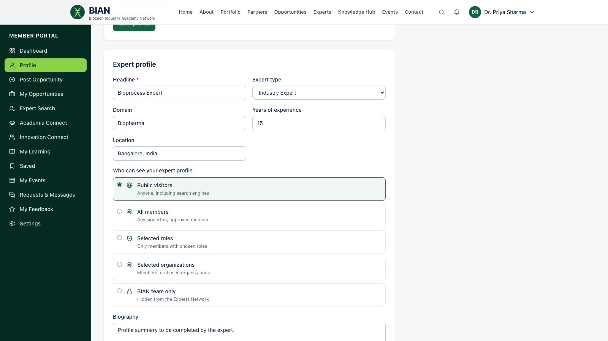

# Guide for experts

**For:** any member who wants to be found in the **Experts Network**, usually Individual Experts (SME), Professionals and Alumni.

## Create your expert profile

1. **Dashboard → Profile → Expert profile.**
2. Add a one-line **headline**, a short **bio**, your **expert type** (industry expert, research expert, trainer, consultant or mentor), your domain, **skills**, **expertise areas**, years of experience and location.
3. Under **Who can see your expert profile**, choose an audience. These are the same options the BIAN team uses for its own pages:
   - **Public visitors**: anyone, including visitors.
   - **All members**: any signed-in member.
   - **Selected roles**: only members with the roles you pick, for example *Student* or *Industry Member*.
   - **Selected organizations**: only members of the organisations you pick.
   - **BIAN team only**: hidden from the Experts Network. Useful while you prepare your profile.
4. Tick **Show my email address to signed-in members** only if you want members to contact you directly. Otherwise all contact goes through the secretariat.
5. Tick **Available for mentoring** if you take mentees.
6. Click **Save**. New profiles are **reviewed by the BIAN team**. You get a notification when yours is approved and listed.

You can update your profile at any time. Audience changes take effect immediately, in listings, profile pages and site search.

## When someone wants to connect

Members send connect requests (mentoring, consultancy, collaboration, training) through your profile. These go to the **BIAN secretariat**, not straight to you. The secretariat contacts you to arrange the introduction. This protects your time and your contact details.

## Everything else

As an expert you are still a member. See the [individual members guide](03-individual-members.md) for opportunities, learning and events.
