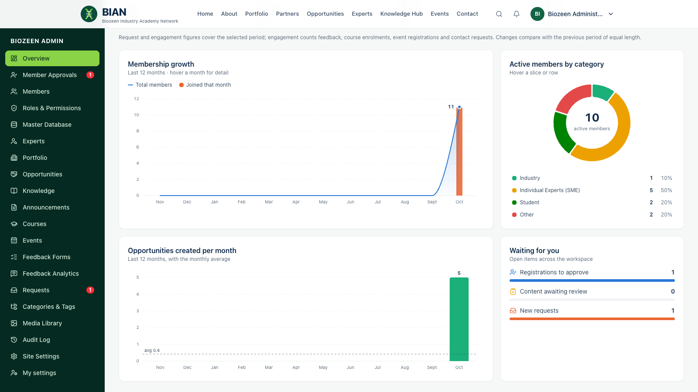

# Guide for Biozeen administrators

**For:** the **Biozeen Administrator** role, which has every permission. Content and membership staff with narrower roles have their own guides: [content team](06-content-team.md) and [membership managers](07-membership-managers.md).

Sign in as usual; you land on the **Admin workspace** (`/admin`). You can switch to your own Member Portal from the account menu.

## Overview dashboard

Live counts of members, organisations, experts and opportunities; collaboration and training requests; items awaiting action; and engagement (feedback, enrolments, event registrations, requests). Each count is compared with the previous period, and the member and opportunity tiles carry a 12-month trend line. Charts show membership growth (running total with members joined each month), active members by category (hover a slice or legend row) and opportunities per month with the monthly average. **Engagement by month** stacks feedback, course enrolments, event registrations and contact requests. **Request pipeline** shows requests received in the chosen period by type and stage (new, in progress, responded, closed), with the median and average time until staff first act on a request. Hover any month or bar for exact figures. A **Waiting for you** panel links to pending approvals, content awaiting review and new requests. Choose the period (7 days to 12 months) at the top right.

The sidebar shows red badges for pending approvals, content awaiting review and new requests. These update without reloading, and the bell notifies you as items arrive.

## Workspace map

Every list uses the same action icons at the end of each row: **View** (eye) opens the public page or a details panel, **Edit** (pencil) and **Delete** (bin, turns red on hover). An action you can't use stays greyed out; hover it to see why.

| Area | What you do there |
|---|---|
| Member Approvals | Approve or reject registrations (see [membership managers](07-membership-managers.md)) |
| Members | Search, edit, suspend or re-activate members; change roles and category; export CSV |
| Roles & Permissions | Create roles and choose their permissions; see how many members hold each |
| Master Database · Experts | Organisation, expert and alumni directories with filters and CSV export |
| Portfolio · Opportunities · Knowledge · Announcements | The visual page builder (see [content team](06-content-team.md)) |
| Courses · Events | Course builder (modules, lessons) and events with registrations |
| Feedback Forms · Feedback Analytics | Build forms; analyse responses by item, course, lesson, member, date, rating and category |
| Requests | Contact, collaboration and expert-connect requests: status, assignment, internal notes, replies |
| Categories & Tags · Media Library | Taxonomy and uploaded files with access settings |
| Audit Log | Who changed what and when. Open an entry to see its full record as JSON, with a copy button |
| Site Settings | Homepage hero, keywords, intro video, secretariat email/phone/address |
| My settings | Your own appearance (theme colour, light/dark), password and devices |

## Roles and permissions

- **Roles & Permissions → New role**: name it and tick its permissions, for example *Content Publisher* with content.manage, content.publish, media.upload and feedback.view.
- Assigning roles that grant admin access requires the **roles.manage** permission. The platform always keeps at least one active Biozeen Administrator.
- Suspending a member ends their sessions and live connection immediately.

## Handle requests

**Requests** lists every enquiry. Open one (or click its notification) to:

1. Set the **status**: new, in progress, responded or closed.
2. **Assign** it to a colleague.
3. Add **internal notes**. These are never shown to the requester.
4. Write a **reply**. The member sees it under *Requests & Messages* and is notified straight away.

## Feedback analytics

Filter by date, content type, a specific item, form, minimum rating, member category and identified/anonymous. Tabs show the **Summary** (trend and distribution), **Courses & lessons** (lessons rated below 3 are flagged), individual **Responses**, and **By member**. *By member* is available only with the *view identified feedback* permission. Anonymous answers never reveal who sent them, even to you. **Export CSV** downloads the filtered responses.

## Site settings

Change the homepage headline, highlight text, keywords and intro video, plus the secretariat's contact details. These appear in the footer and on the Contact page.

## Platform configuration (for whoever runs the server)

These are set in `server/.env`. See the project README for the full list.

| Setting | Effect |
|---|---|
| `EMAIL_ENABLED` + `SMTP_*` + `MAIL_FROM` | Sends verification, password-reset and sign-in-code emails. While `false`, emails are written to the server log |
| `LOGIN_OTP_ENABLED` | Requires an emailed 6-digit code after the password. Turn on only once email works |
| `REQUIRE_APPROVAL` · `REQUIRE_EMAIL_VERIFICATION` | Whether new members need approval and email verification |
| `AUTO_INIT_DB` | Fills an empty database from `db/data` on first start |

## Before going live

- Replace the sample organisations, experts, listings, events and announcements, and the placeholder text on the About and services pages.
- Change or remove the demo accounts and the default admin password.
- Configure email, then decide whether to enable sign-in codes.
- Review **Roles & Permissions** so that each staff member has only what they need.
