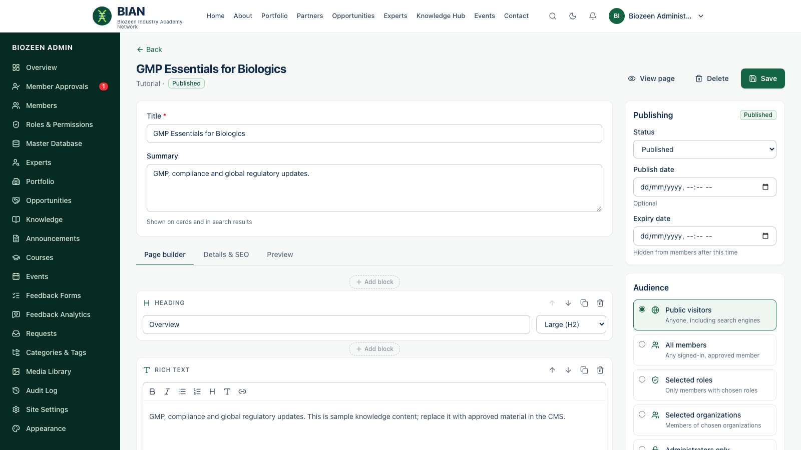

# Guide for the content team

**For:** **Content Editors** (create and edit, then submit for review) and **Content Publishers** (also publish, schedule, archive and delete).

## Who can do what

| Action | Content Editor | Content Publisher |
|---|---|---|
| Create and edit portfolio pages, opportunities, knowledge resources, announcements, courses and events | ✓ | ✓ |
| Upload media | ✓ | ✓ |
| Save as *Draft* or *Pending review* | ✓ | ✓ |
| Publish, schedule, unpublish, archive | — | ✓ |
| Delete | — | ✓ |
| Build feedback forms and view analytics | ✓ | ✓ |

Publishers get a notification whenever a member or an editor submits something for review.

Some options can be switched off for the whole platform by the developer console: individual statuses (Draft, Pending review and Approved, Scheduled, Unpublished, Archived), expiry dates, the Preview tab, SEO fields, homepage featuring, and some block types. Anything switched off simply doesn't appear in the editor. *Published* is always available.

## Find your way around the lists

Each list (Portfolio, Opportunities, Knowledge, Announcements, Courses, Events) has status tabs, a search box, and the same icons at the end of each row: **View** (blue eye) opens the page as visitors see it, **Edit** (amber pencil) opens the editor, and **Delete** (red bin) removes it after you confirm. Delete is greyed out for editors; hover it to see why.

## Create a page

1. Choose the section in the sidebar (**Portfolio**, **Opportunities**, **Knowledge** or **Announcements**) and click **New**.
2. Enter the **title** and a **summary**. The summary appears on cards and in search results.
3. **Page builder → Add block.** Build the page from blocks: heading, rich text, image, gallery, video, file download, columns, cards, list, table, FAQ, callout, call to action, quote, divider, related content and an inline feedback form. Use the **Move up** / **Move down** arrows to reorder, **Duplicate** to copy a block, or the red bin to remove it. A block whose type has been switched off is marked *Hidden* and isn't shown on the page until it's switched back on.
4. **Details & SEO** (just **Details** when SEO is switched off): type-specific fields (for opportunities: organisation, type, location, deadline, apply link; for knowledge: section), the featured image, categories and tags, and SEO text.
5. **Audience:** *Public visitors*, *All members*, *Selected roles* (for example Students only), *Selected organisations*, or *Administrators only*.
6. **Publishing:** set the status. Editors choose *Draft* or *Pending review*. Publishers can also choose *Published*, or *Scheduled* with a publish date. An optional **expiry date** hides the item automatically.
7. Check the **Preview** tab, then **Save**.

Files attached to a page can be downloaded only by people who can see that page.

## Review and publish (publishers)

1. Open the item from its notification, or filter the list by *Pending review*.
2. Edit if needed, check the audience, and set the status to **Published** (or *Scheduled*).
3. Save. A member who submitted it is notified that it is live. For announcements, opportunities and events, **everyone in the audience is notified**, so check the audience before publishing.

## Courses

**Courses → New course.** Add the summary, objectives, thumbnail and audience. Then add **modules** and **lessons**. Click a lesson or its pencil to open it in the same page builder; reorder or remove modules and lessons with the arrows and bin. Attach a course-level or lesson-level feedback form if you want ratings.

## Events

**Events → New event.** Set the type, start and end, format (in person, online, hybrid), venue or meeting link, and registration (capacity, deadline, or an external link). The meeting link is shown only to registered attendees. The **Registrations** tab lists sign-ups.

## Feedback forms

Forms are listed in a table with their responses and status. Use the eye to open a form, the violet chart icon for its analytics, and the bin to delete a form that has no responses yet.

**Feedback Forms → New form.** Add star ratings, a 0–10 recommendation, single or multiple choice, yes/no, and short or long text questions. Choose whether responses are identified, anonymous or the respondent's choice, and whether people can respond once or repeatedly. Attach the form to an item, or place it with a *feedback* block. Editing questions on a form that already has responses creates a new version, so earlier answers keep their original questions.
