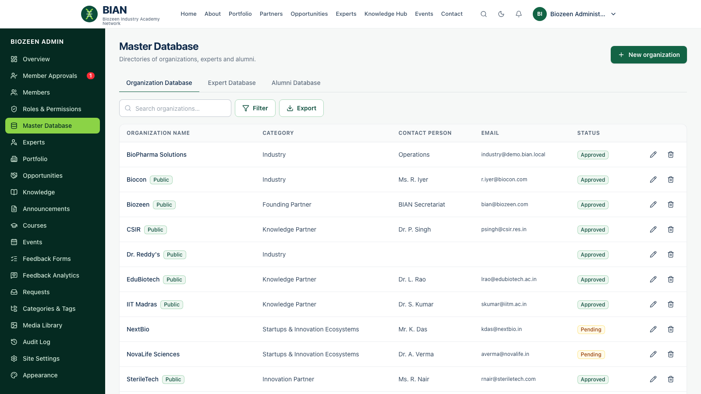

# Guide for membership managers

**For:** the **Membership Manager** role. You approve members, keep the organisation, expert and alumni directories accurate, and handle incoming requests.

You are notified when someone registers, creates an expert profile, or sends a request.

## Approve new members

1. **Member Approvals** lists pending registrations, and shows whether each person has verified their email.
2. Check the details. For organisation registrations, check the organisation name.
3. Click **Approve**. The suggested roles are *Member* plus the category role, for example *Student*. Adjust them if needed, then **Approve member**.
4. The member is notified and can sign in. A pending organisation created at registration is approved at the same time, but stays **internal** until you make it public in the Master Database.
5. Use **Reject** for registrations that don't qualify.

> You can assign audience roles. Roles that grant admin access need an administrator with role-management rights.

## Manage members

**Members:** search by name or email and filter by category or status. Open a member to change their category, roles, organisation or status. Setting the status to *Suspended* or *Inactive* signs them out everywhere at once. **Export** downloads a CSV.

## Master Database

Tabs for **Organisations**, **Experts** and **Alumni**, each with search, **Filter** and **Export**.

- **Organisations:** name, type, partner tier (founding, knowledge, industry, innovation), description, logo, website, contact, collaboration areas and initiatives. An organisation appears in the public Partner Ecosystem only when its status is **Approved** and its visibility is **Public partner profile**. Contact details are never shown publicly. An organisation with linked members can't be deleted; mark it *Inactive* instead.
- **Experts:** review new profiles and set the status to **Approved** to list them. The expert is notified. Visibility (public, members only, hidden) stays the expert's choice.
- **Alumni:** members in the Alumni category, with institution and graduation year.

## Requests

**Requests** works as described in the [administrator guide](05-administrators.md#handle-requests): set the status, assign, add internal notes and reply. The member sees your reply under *Requests & Messages* and is notified immediately. Expert-connect requests show which expert was asked for; contact the expert to arrange the introduction.
