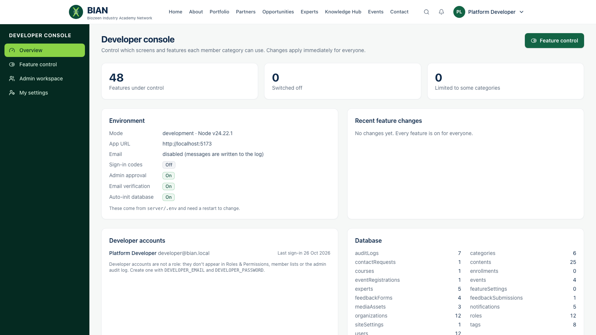
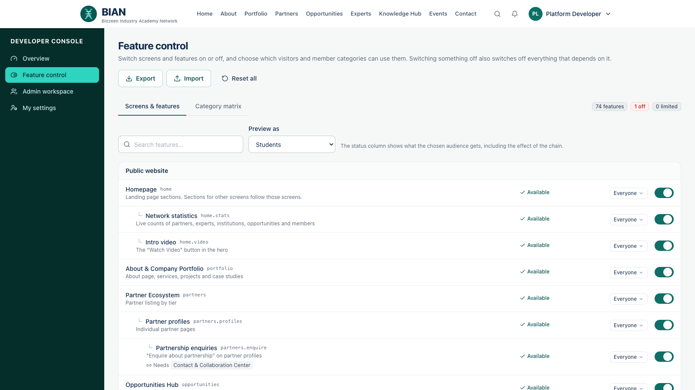

# Guide for developers

**For:** holders of a **developer account**. A developer account is not a role. It never appears in Roles & Permissions, the member lists or the admin audit log, and administrators cannot edit or suspend it. Developers can use everything, including the admin workspace, plus the **Developer console**.

## Get a developer account

Developer accounts are created on the server, not in the app. Set these in `server/.env` and restart the API:

```
DEVELOPER_EMAIL=you@example.com
DEVELOPER_PASSWORD=a-long-unique-password
```

The account is created on the next start if it doesn't exist. An existing ordinary account with that email is **never** promoted, so nobody can claim developer access by registering first. Sign in as usual; you land on the **Developer console** (`/developer`).

## Overview



Shows how many features are switched off or limited, the server's environment settings (email, sign-in codes, approval rules), recent feature changes, developer accounts and database collection sizes.

## Feature control



Every screen and feature is listed under six groups: **Public website**, **Member portal**, **Across the platform**, **Publishing workflow**, **Page builder** and **Admin workspace**. Features are nested under the screen they belong to.

- **Publishing workflow** covers each status an editor can choose (Drafts, Review & approval, Scheduled publishing, Unpublish, Archive), expiry dates, the editor's Preview tab, SEO settings and homepage featuring. *Published* is always available. Switching off Review & approval also stops members posting opportunities, because their posts need review.
- **Page builder** covers each family of blocks: media, file downloads, layout, call-to-action, related content and inline feedback. Switched-off blocks disappear from the editor's block menu and from published pages; existing blocks are kept and come back when the feature is switched on.
- **Admin workspace** includes each admin screen plus finer tools: overview analytics, CSV exports, registration lists, notes and assignment on requests, replies to members, feedback by member and the alumni database.

For each feature you can:

- **Switch it on or off** with the switch on the right. Off means off for everyone except developers, including administrators.
- **Limit who can use it** with the audience menu: *Visitors* and each member category (Startups, Academia, Industry, Experts (SME), Alumni, Students, Professionals, Other members). Features that need a signed-in member don't offer *Visitors*. Admin-workspace features are on/off only. Staff with admin access are not limited by audience, because they manage the content.

### The chain

A feature is available only when it, the screen it sits under, and everything it **Needs** are all available. For example:

- Switching off **Contact & Collaboration Center** also switches off *Partnership enquiries*, *Request introductions*, *Requests & Messages* and the admin *Requests inbox*.
- Switching off **Member Portal** switches off everything members do from their dashboard, such as posting requirements, enrolling in courses and registering for events.
- Limiting **Experts Network** to *Industry* hides expert search, expert self-service and introductions for every other category.

Before you switch off something others depend on, a panel lists every feature that will stop working. Their own settings are kept, so they return when you switch the parent back on.

**Preview as** shows the *Status* column for any audience, so you can see exactly what a student, a visitor or staff will get, and which link in the chain is responsible.

### Category matrix

The **Category matrix** tab shows every feature against every audience: ✓ available, ✕ blocked by its own setting, – blocked by something it depends on. Click a cell to allow or block that audience.

### Export, import and reset

- **Export** downloads the current configuration as JSON, for example to copy it to another environment.
- **Import** applies a configuration file. It replaces every current setting.
- **Reset all** switches everything back on for everyone.

## What members see

Changes apply immediately. Open sessions update live: menu items, buttons and page sections for switched-off features disappear. Opening a switched-off page directly shows "This section is not available". The API enforces the same rules, so a switched-off feature can't be used by calling the API either.

## Good practice

- Make changes in a quiet period and check them with **Preview as** before announcing.
- Export the configuration before large changes so you can import it back.
- Keep at least one developer account's password in a password manager. There is no in-app reset for developer accounts beyond the normal "Forgot password" email.
