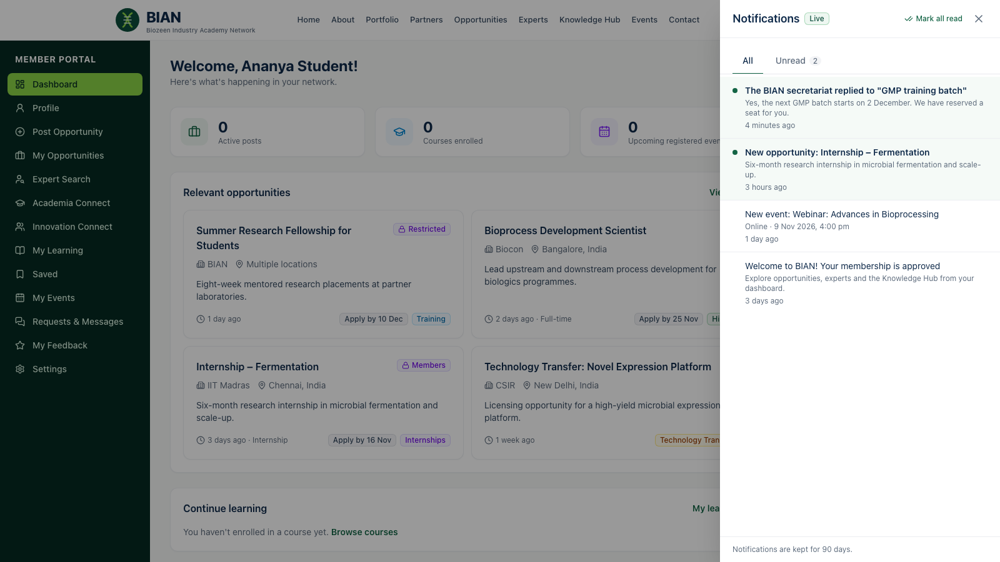
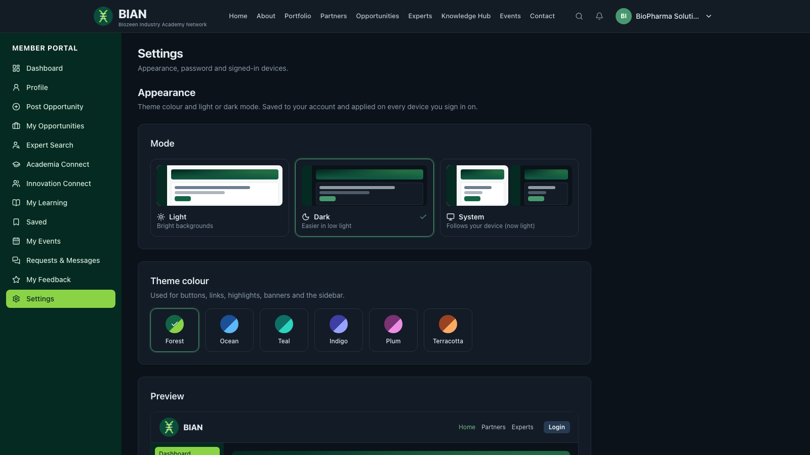

# BIAN user guides

Step-by-step guides for each kind of BIAN user. A slide overview of the platform is in [../presentation/BIAN-Platform-Overview.pptx](../presentation/BIAN-Platform-Overview.pptx). Find your role below and open your guide. The section [Things everyone can do](#things-everyone-can-do) applies to all signed-in users.

| I am… | Category or role | Guide | PDF |
|---|---|---|---|
| A visitor who hasn't joined | — | [Visitors](01-visitors.md) | [PDF](pdf/BIAN-User-Guide-01-Visitors.pdf) |
| Representing a startup, incubator, university, research institute or company | Startups & Innovation · Academia & Research · Industry | [Organisation members](02-organisation-members.md) | [PDF](pdf/BIAN-User-Guide-02-Organisation-members.pdf) |
| Joining as an individual | Individual Expert (SME) · Alumni · Student · Professional | [Individual members](03-individual-members.md) | [PDF](pdf/BIAN-User-Guide-03-Individual-members.pdf) |
| Listed, or want to be listed, as an expert | Any member with an expert profile | [Experts](04-experts.md) | [PDF](pdf/BIAN-User-Guide-04-Experts.pdf) |
| Running the platform for Biozeen | Biozeen Administrator | [Administrators](05-administrators.md) | [PDF](pdf/BIAN-User-Guide-05-Administrators.pdf) |
| Writing or publishing content | Content Editor · Content Publisher | [Content team](06-content-team.md) | [PDF](pdf/BIAN-User-Guide-06-Content-team.pdf) |
| Approving members and keeping directories | Membership Manager | [Membership managers](07-membership-managers.md) | [PDF](pdf/BIAN-User-Guide-07-Membership-managers.pdf) |

> **Category or role?** Your *category* is what you chose when you registered (for example Student). Your *roles* decide what you can see and do. When you are approved you get the **Member** role plus the role for your category. An administrator can add or change roles later.

## Things everyone can do

### Sign in

1. Go to **Login** (top right) and enter your email and password. Tick **Remember me** on your own device to stay signed in for 30 days; otherwise you stay signed in for one day.
2. **If a sign-in code is asked for**, check your email for a 6-digit code and type it in. The code expires after 10 minutes. You can request a new one with **Resend code** (after 30 seconds). After 5 wrong codes, start again from the password step.
3. You land on your **Member Portal** (`/dashboard`), or on the **Admin workspace** (`/admin`) if you are staff.

**Forgot your password?** Use **Forgot Password?** on the login page. The emailed link is valid for one hour.

> Whether a sign-in code is required is set by your administrator. Until email is set up, the platform shows codes and links on screen in development only. Live sites must have email configured first.

### Notifications

The **bell** in the header shows how many unread notifications you have. They arrive live, without reloading the page, and also pop up briefly at the bottom of the screen.

- Click the bell to see the latest notifications. Click one to open the page it refers to; it is then marked as read.
- **Mark all read** clears the badge.
- **View all notifications** (or **Dashboard → Notifications**) shows the full list with an *Unread* filter. Notifications are kept for 90 days.

| You are told when… | Who receives it |
|---|---|
| Your membership is approved | The new member |
| The secretariat replies to your request, or its status changes | The member who sent it |
| Your submitted opportunity is published | The member who submitted it |
| Your expert profile is approved | The expert |
| A new announcement, opportunity or event is published for you | Every member in that item's audience |
| Someone registers and awaits approval | Staff who approve members |
| A contact, collaboration or expert-connect request comes in | Staff who handle requests |
| A member submits an opportunity for review | Staff who can publish |
| A member creates an expert profile | Staff who manage experts |

### Appearance: theme colour and light/dark mode

Open **Dashboard → Appearance**, or **Appearance** in your account menu.

1. Choose a **mode**: *Light*, *Dark*, or *System* (follows your computer or phone).
2. Choose a **theme colour**: Forest (the BIAN default), Ocean, Teal, Indigo, Plum or Terracotta.
3. The **Preview** shows the header, banner, sidebar, cards, buttons and badges in your choice before you apply it.
4. Click **Apply theme**. Your choice is saved to your account and follows you to any device you sign in on. **Reset to default** returns to Forest with System mode.

The **moon/sun** button in the header switches between light and dark mode in one click. It works for visitors too and is remembered on that device.

### Account settings

**Dashboard → Settings** lets you change your password (other devices are signed out) or **sign out of all devices**.
